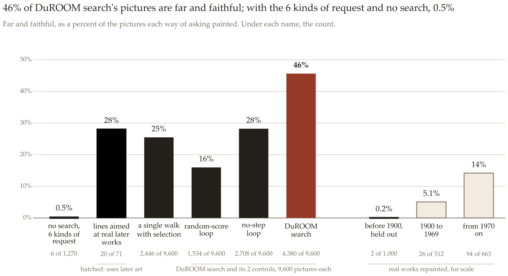

# DuROOM: Discovering Unexplored Regions On and Off the Manifold

[](https://doi.org/10.5281/zenodo.24383932)

Code for the MA thesis *Discovering Unexplored Regions On and Off the Manifold: Novelty Search in Foundation Model Embedding Spaces* (Avi Oberoi, MA in Computational Social Science, University of Chicago, 2026). Appendix: [`docs/DuROOM-appendix.pdf`](docs/DuROOM-appendix.pdf).

## Abstract

Can the works a culture has already made tell us where it has not been, when all we measure is how far a candidate sits from them? We read 172,171 WikiArt works as points in a foundation model's embedding space, freeze the corpus at 1900, and use the works made after it as a future we already know. A place is unexplored when a picture there is far from the works before 1900. In CLIP, about 26% of the works from 1960 on are far by this measure, against 1% of the works before 1900. Far alone is not enough, as noise is far too. We also need a picture to be faithful, i.e., to come back near the vector we asked for when a pretrained decoder paints it. DuROOM search, a novelty search over CLIP embeddings with CMA-ES, restarts each round from the pictures the decoder did paint. It paints far and faithful pictures 2.9 and 1.6 times as often as the same loop told random scores, with its step and without it. With no search, 0.5% of the pictures from 6 kinds of simple request are far and faithful, and 20% of those from requests read from noise images. For 88% of the search's far and faithful pictures a real work dated 1900 or later lies as close to it as nearly every repainted real work lies to its nearest real work, and none dated before, as for most of the controls' pictures. So the answer is yes, in the sense we test it. Where no real work lies that close, off the manifold of the art we have, the search paints more than its controls in sum, though not at every start.

## Main findings



| | DuROOM search | random-score loop, with step | random-score loop, no step |
|---|---|---|---|
| far and faithful, of 9,600 pictures | 4,380 (46%) | 1,534 (16%) | 2,708 (28%) |
| hits | 120 | 65 | 40 |
| off the manifold, against today's reference | 1,716 | 57 | 135 |

- Hits: kept pictures that pass every check. Today's reference: repainted works of every date.
- No search, 6 kinds of request: 6 of 1,270 far and faithful (0.5%).
- Of the search's 4,380 far and faithful pictures: 92% on the manifold; 88% where art went only after 1900.
- 5 starts x 3 loops; 60 rounds x 32 pictures per run.
- The manifold line set on other works, and the labels under each line: [`docs/line-sample.md`](docs/line-sample.md).
- Rerunning `run/07_readouts.sh` on the thesis's saved runs gives every number above exactly.

## How to cite

```bibtex
@mastersthesis{oberoi2026duroom,
  author = {Oberoi, Avi},
  title  = {Discovering Unexplored Regions On and Off the Manifold: Novelty Search in Foundation Model Embedding Spaces},
  school = {University of Chicago},
  type   = {MA thesis, Computational Social Science},
  year   = {2026},
  url    = {https://github.com/avioberoi/duroom}
}
```

```bibtex
@software{oberoi2026duroomcode,
  author = {Oberoi, Avi},
  title  = {DuROOM: Discovering Unexplored Regions On and Off the Manifold: Novelty Search in Foundation Model Embedding Spaces},
  year   = {2026},
  doi    = {10.5281/zenodo.24383932},
  url    = {https://github.com/avioberoi/duroom}
}
```

Also: [`CITATION.cff`](CITATION.cff) (GitHub: "Cite this repository").

## Requirements

Two environments; versions pinned as run.

| file | Python | for | key pins |
|---|---|---|---|
| `requirements.txt` | 3.10.19 | corpus encoders, exact readings, readouts, corpus analyses | torch 2.1.0+cu121, open-clip-torch 2.23.0, timm 1.0.24, transformers 4.36.0, faiss-gpu 1.7.2, numpy 1.26.0, OpenAI `clip` |
| `requirements-search.txt` | 3.12.13 | search loop, decoder renders (`DUROOM_SEARCH_ENV`) | torch 2.10.0+cu126, diffusers 0.37.0, transformers 5.3.0, open_clip_torch 3.3.0, timm 1.0.25, cma 4.4.4, numpy 2.3.5 |
| `figures/requirements-figures.txt` | 3.14.0 | figures | matplotlib 3.11.1, numpy 2.4.3, pymupdf 1.26.7 |

- GPU for encoding, rendering and search (runs used NVIDIA H200, A100, RTX 6000; renders differ slightly across cards, so expect counts within run-to-run variance, not equality).
- Models: OpenAI CLIP ViT-L/14, DINOv3-L, SigLIP SO400M, AIMv2-huge; decoder `lambdalabs/sd-image-variations-diffusers`.
- `SPHERE_CLIP=quickgelu` (scripts stop otherwise).

## Data

- Images: [WikiArt images on Kaggle](https://www.kaggle.com/datasets/yangyuwang/wikiart-images) (Yangyu Wang, MIT licence).
- `corpus/`: work ids in row order, the 1,166 removed ids, metadata (artist, title, year, style, genre, image URL).
- `python corpus/make_corpus.py KAGGLE_DIR WIKIART_DIR`: builds the layout the code reads.

## Run

`cp run/env.sh.example run/env.sh`, set the paths, then in order:

| step | does |
|---|---|
| `01_encode.sh` | corpus in CLIP, DINOv3, SigLIP |
| `02_newaxis.sh` | the direction the corpus moved after 1900 |
| `03_reference.sh` | pools; repainted reference works; fidelity limit |
| `04_search.sh` | DuROOM search, its 2 controls, the single walk; runs against today's reference; the search scored in CLIP |
| `05_readings.sh` | exact readings of every run's pictures |
| `06_measures_prep.sh` | baselines, bars, lines, leftover basis |
| `07_readouts.sh` | far and faithful, hits, on/off, dated split, no-search baseline |
| `08_corpus_analysis.sh` | the corpus chapter (Q1 to Q6) |
| `09_search_extras.sh` | free search, restart variants, decoder walk, the remaining readouts (with the search scored in CLIP) |
| `10_corpus_extras.sh` | the remaining corpus analyses |
| `11_figures.sh` | figures |
| `12_more_readouts.sh` | far read in CLIP and AIMv2, the lean of each round, far and faithful by round, the regions the loops pass through, the manifold line on other works |

- Code: `encode/`, `search/`, `measure/`, `data/`, `figures/`.
- Not shipped: run outputs; the hand-picked gallery selections and their reading notes (galleries need a reader's own `figures/marks/`).
